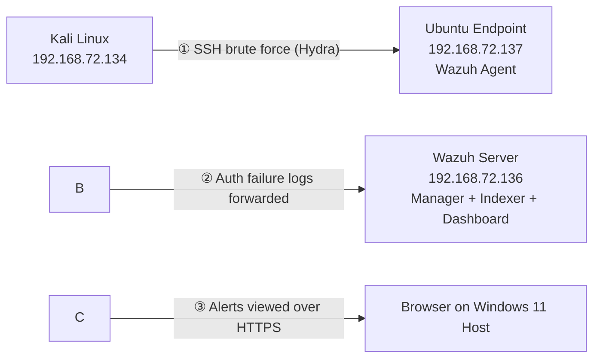

# SOC Simulation Lab — Wazuh / ELK Threat Detection

A hands-on Security Operations Center (SOC) lab built from scratch on VMware Workstation Pro, simulating a real attack against a monitored Linux endpoint and detecting it end-to-end with Wazuh.

This is the second project in a two-part portfolio (see [Project 1: Ansible Automation](https://github.com/Alpha1ne)) demonstrating practical, hands-on security engineering skills backed by CEH, CCNA, RHCE, and MCSA certifications.

\---

## Overview

|||
|-|-|
|**Goal**|Build a working SOC environment: deploy Wazuh (SIEM/XDR), monitor a Linux endpoint, simulate a real attack, and detect it|
|**Attack simulated**|SSH brute-force login attempt (Hydra)|
|**Result**|Wazuh correctly detected and escalated the attack via its brute-force correlation rule (rule ID 5763, level 10)|
|**Environment**|VMware Workstation Pro, Windows 11 host, 16GB RAM|

\---

## Architecture

!\[Architecture Diagram](docs/architecture-diagram.svg)

**Topology summary:**

* All VMs sit on a single VMware **NAT network** (`192.168.72.0/24`) — isolated from the home LAN, but with outbound internet access for package installs
* **Wazuh Server** (`192.168.72.136`) — Ubuntu Server 24.04 LTS, runs the Wazuh Manager, Indexer, and Dashboard together (all-in-one install)
* **Ubuntu Endpoint** (`192.168.72.137`) — Ubuntu Server 24.04 LTS, runs the Wazuh Agent, acts as the monitored "victim" host
* **Kali Linux** (`192.168.72.134`) — attacker VM, used to run Hydra against the endpoint; only powered on for attack simulations
* The Wazuh Dashboard is accessed from a normal browser on the Windows 11 host over HTTPS — no GUI is installed on either Ubuntu VM



\---

## Tech Stack

* **Hypervisor:** VMware Workstation Pro
* **SIEM:** Wazuh 4.14.x (Manager, Indexer, Dashboard — OpenSearch-based)
* **OS:** Ubuntu Server 24.04 LTS (x2), Kali Linux (attacker)
* **Attack tooling:** Hydra (SSH brute-force)
* **Networking:** VMware NAT (VMnet8), static IPs via netplan / NetworkManager

\---

## Build Steps

1. **Network planning** — confirmed VMware NAT subnet (`192.168.72.0/24`) in the Virtual Network Editor before building any VM
2. **Wazuh Server** — installed Ubuntu Server 24.04 LTS (headless, no GUI), assigned static IP, ran Wazuh's official all-in-one installer (`wazuh-install.sh -a`)
3. **Ubuntu Endpoint** — installed Ubuntu Server 24.04 LTS (headless), assigned static IP, deployed the Wazuh Agent via the dashboard's "Deploy new agent" wizard, pointed at the manager's IP
4. **Kali Linux** — installed via the Installer image (Xfce desktop retained for tooling flexibility), assigned static IP on the same NAT network
5. **Verification** — confirmed the endpoint registered as `Active` in the Wazuh dashboard, with baseline modules (File Integrity Monitoring, Configuration Assessment, MITRE ATT\&CK mapping) running automatically
6. **Attack simulation** — created a deliberately weak test account (`testuser`) on the endpoint, then ran:

```
   hydra -l testuser -P passwords.txt ssh://192.168.72.137
   ```

7. **Detection** — confirmed in the dashboard's Threat Hunting module

\---

## Detection Results

Filtering alerts by `rule.groups:authentication\_failed` for the endpoint showed **10 total events, 10 authentication failures, 0 successes** — consistent with the brute-force attempt.

The key event in the raw log:

```
sshd: brute force trying to get access to the system. Authentication failed.
Rule ID: 5763   |   Level: 10   |   Agent: ubuntu-endpoint
```

This is Wazuh's dedicated brute-force **correlation rule** — distinct from the individual level-5 `authentication failed` events also logged for each attempt. Wazuh recognized the *pattern* of repeated failures from a single source and escalated severity accordingly (level 5 → level 10), rather than just logging isolated noise.

**MITRE ATT\&CK mapping:** the endpoint's ATT\&CK view attributed 11 events to the **Credential Access** tactic (T1110 – Brute Force), confirming Wazuh correctly classified the activity against an industry-standard adversary framework.

!\[Brute Force Detection](docs/screenshots/brute-force-detection.png)

!\[24-Hour Dashboard Overview](docs/screenshots/dashboard-24h-overview.png)

!\[Authentication Failure Summary](docs/screenshots/auth-failure-summary.png)

\---

## Key Takeaways

* Deployed a functioning SIEM (Wazuh) from a bare OS install to live threat detection
* Configured static networking across multiple VMs on an isolated NAT segment
* Simulated a real, working attack (not a synthetic test event) and traced it through the full detection pipeline: attack → log generation → agent forwarding → manager correlation → dashboard alert
* Validated detection against the MITRE ATT\&CK framework
* Practiced safe lab hygiene: dedicated low-privilege test account for the attack target, isolated network segment, controlled attacker VM

\---

## Future Work (Phase 2)

* Add a **Windows 11 endpoint** with Sysmon + Wazuh Agent, to demonstrate cross-platform monitoring
* Expand attack simulations beyond SSH brute-force (e.g. port scanning detection, file integrity monitoring triggers)
* Build custom Wazuh detection rules/dashboards tailored to the simulated scenarios

\---

## Author

**Athul** — CEH · CCNA · RHCE · MCSA
GitHub: [Alpha1ne](https://github.com/Alpha1ne)

