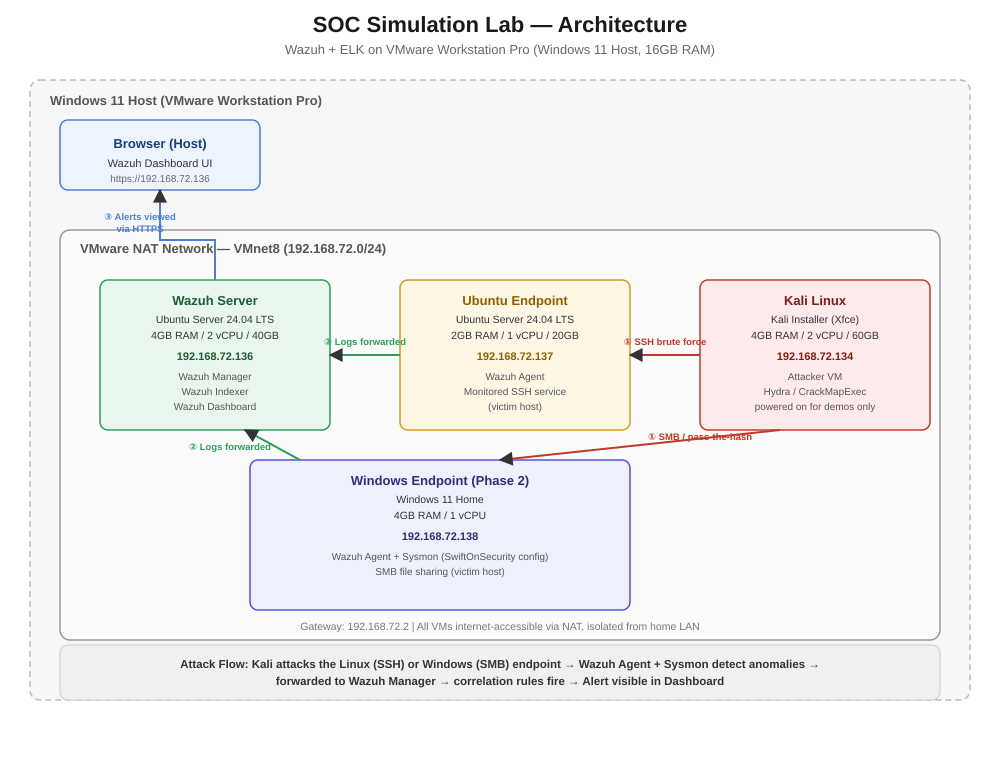
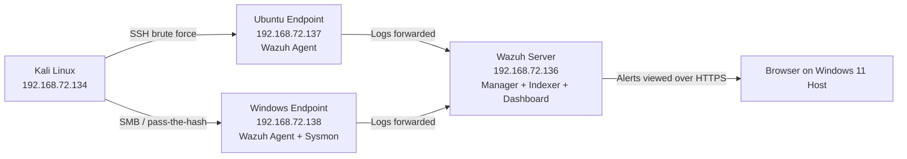
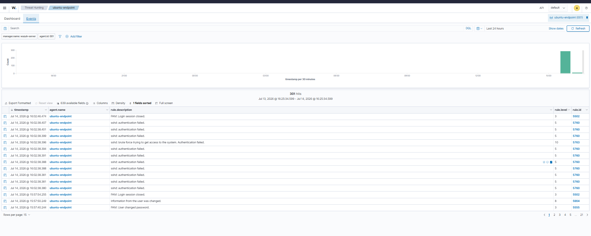
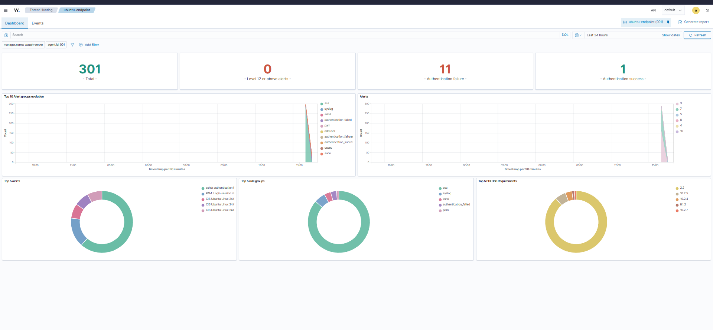
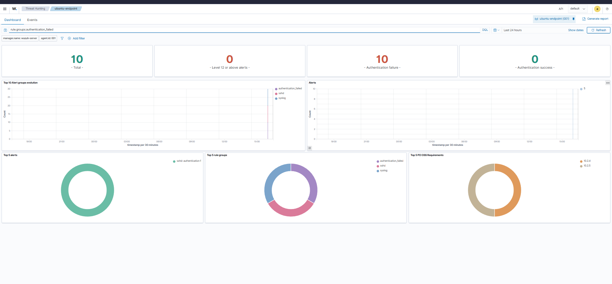
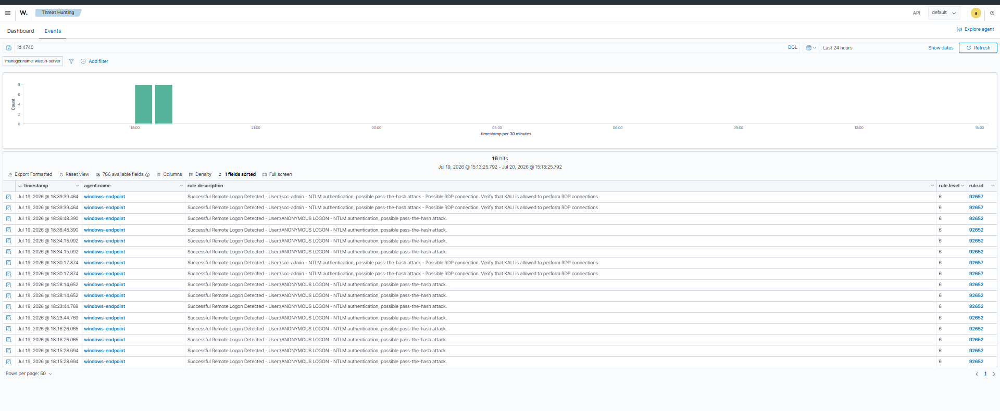
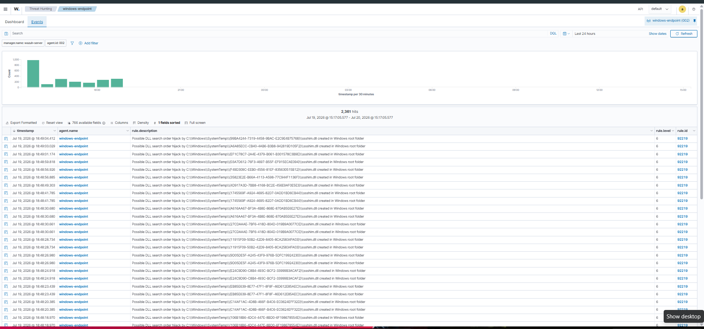
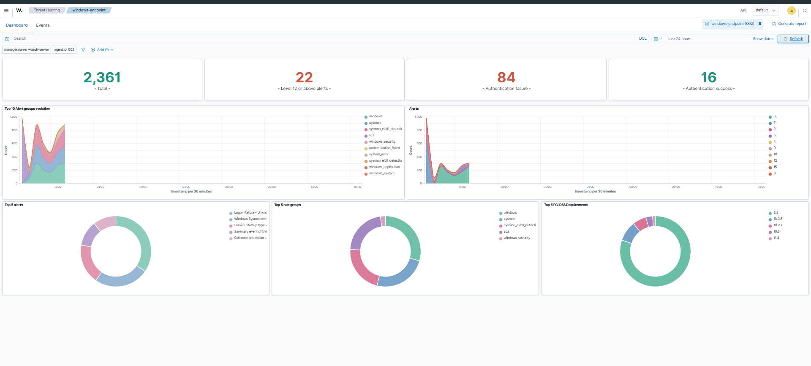

# SOC Simulation Lab — Wazuh / ELK Threat Detection

A hands-on Security Operations Center (SOC) lab built from scratch on VMware Workstation Pro, simulating real attacks against monitored Linux and Windows endpoints and detecting them end-to-end with Wazuh.

This is the second project in a two-part portfolio (see [Project 1: Ansible Automation](https://github.com/Alpha1ne)) demonstrating practical, hands-on security engineering skills backed by CEH, CCNA, RHCE, and MCSA certifications.

---

## Overview

| | |
|---|---|
| **Goal** | Build a working SOC environment: deploy Wazuh (SIEM/XDR), monitor Linux and Windows endpoints, simulate real attacks, and detect them |
| **Attacks simulated** | SSH brute-force (Linux, via Hydra); SMB authentication / pass-the-hash activity (Windows, via Hydra + CrackMapExec) |
| **Result** | Wazuh detected and correctly escalated both attacks via dedicated correlation rules, with MITRE ATT&CK mapping |
| **Environment** | VMware Workstation Pro, Windows 11 host, 16GB RAM |

---

## Architecture



**Topology summary:**
- All VMs sit on a single VMware **NAT network** (`192.168.72.0/24`) — isolated from the home LAN, but with outbound internet access for package installs
- **Wazuh Server** (`192.168.72.136`) — Ubuntu Server 24.04 LTS, runs the Wazuh Manager, Indexer, and Dashboard together (all-in-one install)
- **Ubuntu Endpoint** (`192.168.72.137`) — Ubuntu Server 24.04 LTS, runs the Wazuh Agent, monitored "victim" host for SSH attacks
- **Windows Endpoint** (`192.168.72.138`) — Windows 11 Home, runs the Wazuh Agent and Sysmon (SwiftOnSecurity config), monitored "victim" host for SMB attacks
- **Kali Linux** (`192.168.72.134`) — attacker VM, used to run Hydra and CrackMapExec against both endpoints; only powered on for attack simulations
- The Wazuh Dashboard is accessed from a normal browser on the Windows 11 host over HTTPS — no GUI is installed on either Ubuntu VM



---

## Tech Stack

- **Hypervisor:** VMware Workstation Pro
- **SIEM:** Wazuh 4.14.x (Manager, Indexer, Dashboard — OpenSearch-based)
- **OS:** Ubuntu Server 24.04 LTS (x2 roles), Windows 11 Home, Kali Linux (attacker)
- **Endpoint telemetry:** Sysmon (SwiftOnSecurity config) for enriched Windows process/network logging
- **Attack tooling:** Hydra (SSH brute-force, SMB attempts), CrackMapExec (SMB authentication testing)
- **Networking:** VMware NAT (VMnet8), static IPs via netplan (Linux) / NetworkManager (Kali) / Windows GUI + registry

---

## Phase 1: Linux Endpoint (SSH)

1. **Network planning** — confirmed VMware NAT subnet (`192.168.72.0/24`) in the Virtual Network Editor before building any VM
2. **Wazuh Server** — installed Ubuntu Server 24.04 LTS (headless, no GUI), assigned static IP, ran Wazuh's official all-in-one installer (`wazuh-install.sh -a`)
3. **Ubuntu Endpoint** — installed Ubuntu Server 24.04 LTS (headless), assigned static IP, deployed the Wazuh Agent via the dashboard's "Deploy new agent" wizard, pointed at the manager's IP
4. **Kali Linux** — installed via the Installer image (Xfce desktop retained for tooling flexibility), assigned static IP on the same NAT network
5. **Attack simulation** — created a deliberately weak test account (`testuser`), then ran:
   ```
   hydra -l testuser -P passwords.txt ssh://192.168.72.137
   ```
6. **Detection** — confirmed in the dashboard's Threat Hunting module

### Detection Results

Filtering alerts by `rule.groups:authentication_failed` for the endpoint showed **10 total events, 10 authentication failures, 0 successes** — consistent with the brute-force attempt.

```
sshd: brute force trying to get access to the system. Authentication failed.
Rule ID: 5763   |   Level: 10   |   Agent: ubuntu-endpoint
```

This is Wazuh's dedicated brute-force **correlation rule** — distinct from the individual level-5 `authentication failed` events also logged for each attempt. Wazuh recognized the *pattern* of repeated failures from a single source and escalated severity accordingly (level 5 → level 10), rather than just logging isolated noise. The endpoint's MITRE ATT&CK view attributed 11 events to the **Credential Access** tactic (T1110 – Brute Force).





---

## Phase 2: Windows Endpoint (SMB)

1. **VM build** — installed Windows 11 Home, assigned a static IP via Windows' GUI network settings (registry-level, since Home edition lacks some Pro networking tools)
2. **Sysmon install** — deployed Sysmon with the community-maintained **SwiftOnSecurity** configuration for rich process/network telemetry beyond Windows' default event logs
3. **Wazuh Agent** — deployed via the dashboard wizard; added a custom `<localfile>` entry in `ossec.conf` pointing at the `Microsoft-Windows-Sysmon/Operational` event channel, since the agent doesn't monitor it by default
4. **Attack surface decision** — Remote Desktop (RDP) was ruled out early: Windows 11 **Home edition does not support incoming RDP connections** (Pro/Enterprise-only feature), confirmed via missing firewall rule groups and no listener on port 3389. **SMB file sharing was used instead** — a more realistic lateral-movement vector (MITRE T1021.002) and fully supported on Home edition
5. **Attack simulation** — enabled a password-protected SMB share and ran authentication attempts from Kali using Hydra and CrackMapExec against `smb://192.168.72.138`
6. **Detection** — confirmed via the dashboard's Threat Hunting module for `windows-endpoint`

### Detection Results

The attack window (24h) showed **2,361 total events, 22 level-12-or-above alerts, 84 authentication failures, and 16 authentication successes** on the Windows endpoint.

The standout finding:

```
Successful Remote Logon Detected - User:soc-admin - NTLM authentication, possible pass-the-hash attack -
Possible RDP connection. Verify that KALI is allowed to perform RDP connections.
Rule ID: 92657   |   Level: 6   |   Agent: windows-endpoint

Successful Remote Logon Detected - User:\ANONYMOUS LOGON - NTLM authentication, possible pass-the-hash attack.
Rule ID: 92652   |   Level: 6   |   Agent: windows-endpoint
```

Wazuh correctly identified NTLM authentication activity from Kali as consistent with a **pass-the-hash pattern** (MITRE ATT&CK T1550.002), explicitly calling out the real account name (`soc-admin`) involved in one variant of the alert — a more specific and technique-aware detection than a simple failed/succeeded login count.

Sysmon's enriched telemetry also surfaced a distinct finding without any additional configuration:

```
Possible DLL search order hijack by C:\Windows\SystemTemp\{...}\sshshim.dll created in Windows root folder
Rule ID: 92219   |   Level: 6   |   Agent: windows-endpoint
```

repeated across dozens of events — demonstrating that Sysmon's process/file telemetry lets Wazuh catch technique-level anomalies (T1574.001 – DLL Search Order Hijacking) that basic Windows Event Logs alone would not surface.





---

## Key Takeaways

- Deployed a functioning SIEM (Wazuh) from a bare OS install to live threat detection, across both Linux and Windows endpoints
- Configured static networking across multiple VMs on an isolated NAT segment, using three different methods (netplan, NetworkManager, Windows registry)
- Simulated real, working attacks (not synthetic test events) and traced them through the full detection pipeline: attack → log generation → agent forwarding → manager correlation → dashboard alert
- Diagnosed and worked around a real platform limitation (Windows 11 Home's lack of inbound RDP) by choosing an equally valid, arguably more realistic attack vector (SMB / pass-the-hash)
- Extended Windows telemetry via Sysmon and a custom Wazuh agent configuration to surface technique-level detections (DLL search order hijacking) beyond default logging
- Validated both detections against the MITRE ATT&CK framework
- Practiced safe lab hygiene: dedicated low-privilege test accounts for attack targets, isolated network segment, controlled attacker VM

---

## Future Work

- Build custom Wazuh detection rules/dashboards tailored to the simulated scenarios
- Expand attack simulations further (e.g. port scanning detection, file integrity monitoring triggers)
- Explore lateral movement detection across both endpoints in a single simulated attack chain

---

## Author

**Athul** — CEH · CCNA · RHCE · MCSA
GitHub: [Alpha1ne](https://github.com/Alpha1ne)
